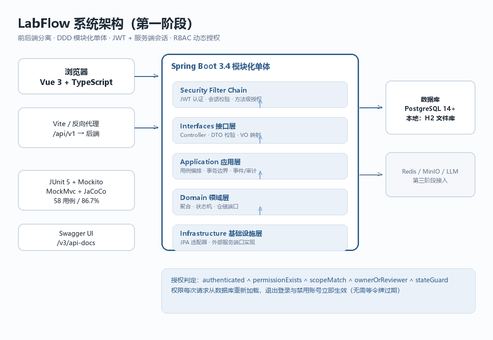
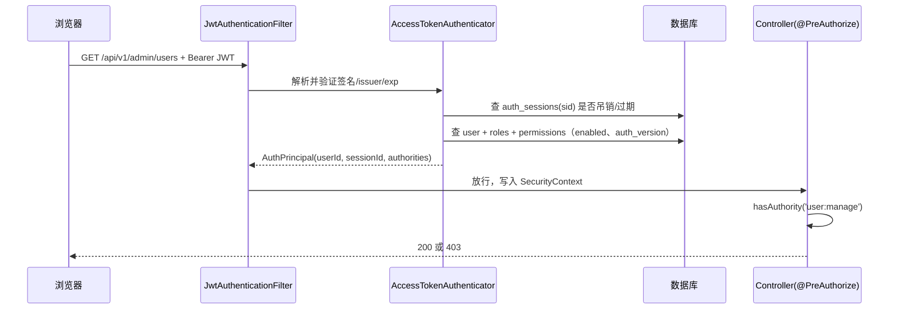

# LabFlow · 科研实验室智能协同管理平台

面向高校科研实验室的前后端分离协同管理系统：科研项目立项与结项、任务分派与验收、周报汇报、资源预约、成果与知识管理，以及基于授权数据的 AI 辅助科研服务。

- 技术栈：**Vue 3 + TypeScript / Spring Boot 3.4 / Spring Security + JWT / PostgreSQL（本地 H2）**
- 当前进度：**第一阶段（可运行底座）已完成并通过测试**，第二、三阶段按 [实施计划](docs/design/05-实施计划.md) 推进
- 设计文档索引：[初步设计总览](docs/design/00-初步设计总览.md) · [架构设计](docs/design/01-架构设计.md) · [数据库设计](docs/design/02-数据库设计.md) · [权限设计](docs/design/03-权限设计.md) · [接口设计](docs/design/04-接口设计.md) · [实施计划](docs/design/05-实施计划.md)
- 进展记录：[log/](log/README.md)（按日期归档的开发日志与里程碑状态）

[](https://github.com/1-Vast/Intelligent-Collaborative-Management-Platform-for-Scientific-Research-Laboratories/actions/workflows/ci.yml)



---

## 1. 项目简介

**题目**：科研实验室智能协同管理平台（LabFlow）
**一句话描述**：面向高校科研实验室，提供科研项目管理、团队任务协作、科研资源调度、研究进度跟踪、成果与知识管理及 AI 辅助科研服务，实现实验室科研活动的数字化、协同化与智能化管理。

**解决什么问题**

| 真实痛点 | 系统对应能力 |
| --- | --- |
| 项目推进分散在聊天记录、个人文档、表格中 | 项目立项/审批/结项、成员与进度 |
| 任务交付标准不一致、缺少验收轨迹 | 任务分派、提交快照、退回理由、验收记录 |
| GPU/工作站靠口头预约，时段重叠 | 资源登记、预约审批、半开区间冲突约束 |
| 论文笔记与实验结论无法检索复用 | 项目知识条目、成果附件与权限检索 |
| 人工汇总多人进展耗时 | 基于授权数据的 AI 周报草稿（人工确认后提交） |
| 跨项目共享账号导致数据越界 | 角色权限 + 实验室/项目作用域 + 数据归属校验 |

**目标用户**：高校科研实验室的系统管理员、实验室负责人（PI）、科研项目负责人、科研人员。

## 2. 团队与分工表

> ⚠️ 请按真实情况填写后再提交；分工必须与 Git 提交记录一致。

| 姓名 | 学号 | 负责模块 | 主要文件/目录 | 贡献比例 |
| --- | --- | --- | --- | --- |
| 待填写 | 待填写 | 身份与授权（认证、RBAC）、数据库设计、工程规范 | `backend/src/main/java/com/labflow/identity/**`、`backend/src/main/resources/db/migration/**`、`docs/design/02-数据库设计.md` | 待填写 |
| 待填写 | 待填写 | 前端页面、测试、业务模块（第二/三阶段） | `frontend/src/**`、`backend/src/test/**`、`docs/testing.md` | 待填写 |

> 若为 1 人组，请改为单人 100% 并注明；2 人组需保证每人都有后端业务代码与测试代码的提交。

## 3. 技术栈与实际版本

| 层次 | 技术 | 版本 |
| --- | --- | --- |
| 前端 | Vue | 3.5.13 |
|  | TypeScript / Vite / Vue Router / Axios | 5.7 / 6.4 / 4.5 / 1.7 |
| 后端 | JDK | 17（LTS） |
|  | Spring Boot / Spring Security | 3.4.13 / 6.4 |
|  | Spring Data JPA（Hibernate 6） | 3.4 |
|  | JJWT（HS256） | 0.12.6 |
|  | springdoc-openapi（Swagger UI） | 2.8.13 |
| 数据库 | PostgreSQL 14+（生产，已由集成测试验证） | 16（测试实例） |
|  | H2 2.x（本地开发，PostgreSQL 兼容模式） | 随 Boot 管理 |
| 迁移 | Flyway | 10.x |
| 测试 | JUnit 5 / Mockito / MockMvc / AssertJ / JaCoCo | 5.11 / 5.x / 6.x / 3.x / 0.8.12 |

> 版本以 `backend/pom.xml`、`frontend/package.json` 与构建日志为准。

## 4. 系统架构

- 架构图见文首图片，或 [`docs/design/01-架构设计.md`](docs/design/01-架构设计.md)。
- 后端为 **DDD 模块化单体**：`interfaces → application → domain`，`infrastructure` 实现领域端口；领域层不依赖 Spring MVC / JPA。
- 技术形态：`浏览器 → Vue 3 → (HTTP /api/v1) → Spring Boot（Security → Interfaces → Application → Domain → Infrastructure）→ PostgreSQL / H2`。
- 前端只负责交互，权限判断全部在后端。

### 4.1 后端包结构

```text
backend/src/main/java/com/labflow/
├── shared/            统一响应、异常、traceId、JWT、安全配置、审计、Clock
└── identity/
    ├── domain/        聚合与仓储端口（User、Role、Permission、AuthSession、RefreshToken…）
    ├── application/   用例编排（AuthService、UserAdminService、RoleAdminService、认证器）
    ├── infrastructure/persistence/  JPA 实体、Spring Data 仓储、端口适配器
    └── interfaces/rest/             Controller、DTO、VO、映射器
```

### 4.2 一次请求的认证时序



要点：JWT **不携带权限**，只带 `sub/sid/av`；权限每次请求从数据库重载，因此改权限后下一次请求即生效；退出登录 / 禁用账号在服务端吊销会话，旧令牌立即 401。

## 5. RBAC 设计

### 5.1 角色列表

| 角色 | 代码 | 职责 |
| --- | --- | --- |
| 系统管理员 | `SYS_ADMIN` | 用户、角色、权限、实验室登记、PI 任命 |
| 实验室负责人 | `PI` | 审批立项/结项/预约，管理本实验室成员 |
| 科研项目负责人 | `PROJECT_LEADER` | 管理所负责项目的成员、任务、周报、成果审核 |
| 科研人员 | `RESEARCHER` | 承接任务、提交周报、申请资源、共享成果（注册默认角色） |

角色 = 能力，`lab_members` / `project_members` = 范围；两者分离。

### 5.2 角色 × 权限矩阵（节选，完整表见 [权限设计](docs/design/03-权限设计.md)）

| 权限码 | SYS_ADMIN | PI | PROJECT_LEADER | RESEARCHER |
| --- | :-: | :-: | :-: | :-: |
| `user:manage` / `role:manage` | ● | | | |
| `lab:create` / `lab:appoint` | ● | | | |
| `lab:read` | | ● | ● | ● |
| `lab:member:manage` | | ● | | |
| `project:create` | | | ● | |
| `project:read` | | ● | ● | ● |
| `project:approve` / `project:close-review` | | ● | | |
| `task:create` / `task:assign` / `task:update` / `task:review` | | | ● | |
| `task:read` | | ● | ● | ● |
| `task:start` / `task:submit` | | | ● | ● |
| `report:create` / `report:submit` | | | ● | ● |
| `report:review` | | ● | ● | |
| `resource:manage` / `booking:review` | | ● | | |
| `artifact:*` / `knowledge:*` | | 审核 | ● | ● |
| `audit:read` | ● | ● | | |

权限码共 **49 条**，全部入库（`permissions` 表），可在后台动态授予/撤销，不写死在代码里。

### 5.3 权限校验在代码中的位置

| 层 | 文件 | 作用 |
| --- | --- | --- |
| 过滤器 | `shared/security/JwtAuthenticationFilter`、`identity/application/AccessTokenAuthenticator` | 令牌 + 会话 + 账号状态校验，装载权限 |
| 方法级 | `interfaces/rest/AdminUserController`（`hasAuthority('user:manage')`）、`AdminRoleController`（`hasAuthority('role:manage')`） | 接口级强制校验，无权限 403 |
| 服务级 | `UserAdminService`、`RoleAdminService` | 最后管理员保护、内置角色保护、角色引用检查 |
| 领域级 | `User.disable/changePassword` 递增 `auth_version`；`Role.ensureDeletable` | 不变量由聚合维护 |

## 6. 数据库设计

- ER 图（Mermaid）与完整表字典：[`docs/design/02-数据库设计.md`](docs/design/02-数据库设计.md)
- 迁移脚本：`backend/src/main/resources/db/migration/V1__schema.sql`（建表）、`V2__seed_data.sql`（种子数据）
- 第一阶段 10 张表：

| 表 | 用途 |
| --- | --- |
| `users` | 用户与密码哈希、启用状态、授权版本 |
| `roles` | 角色（4 个内置角色，`protected` 防误删） |
| `permissions` | 权限目录（49 个接口操作码） |
| `user_roles` | 用户-角色多对多 |
| `role_permissions` | 角色-权限多对多（权限动态来源） |
| `auth_sessions` | 服务端会话（退出即吊销） |
| `refresh_tokens` | 刷新令牌哈希（一次性轮换、重放检测） |
| `labs` | 实验室 |
| `lab_members` | 实验室成员与 PI 关系（作用域来源） |
| `audit_events` | 脱敏操作审计（不含正文与令牌） |

主键、唯一约束（用户名、角色码、权限码）、外键、时间戳与索引齐全；表总数 10 ≥ 课程要求的 8。

## 7. 功能清单

### 7.1 已实现（第一阶段）

| 角色 | 功能 |
| --- | --- |
| 访客 | 注册（用户名唯一、密码强度后端校验、默认 `RESEARCHER`）、登录 |
| 所有登录用户 | 查看当前用户与权限、退出登录（服务端吊销）、刷新令牌轮换、**自助改密（吊销全部会话）** |
| 系统管理员 | 用户分页/搜索/排序、创建、编辑、启用/禁用、分配角色、逻辑删除；角色增删改查、分配权限；权限目录查询；审计日志查询 |
| 审计查看者（`audit:read`） | 管理员看全部脱敏记录；PI 仅看到与本人相关的记录 |
| 安全防护 | 登录失败限流（5 次 / 10 分钟 → 429）、Cookie 接口来源校验、越权与登录失败独立落库审计、数据库控制台仅 dev 放行 |

### 7.2 已知未完成（如实列出）

- 项目、任务、周报、资源预约、成果知识、通知、AI 周报等业务接口属第二、三阶段，**当前仓库尚未实现**；
- 前端覆盖登录、注册、工作台、用户管理、角色权限、审计日志 6 个页面，业务页面待第二阶段；
- 未做浏览器 E2E、Docker Compose、Redis / MinIO / WebSocket（第三阶段）；
- `lab_members`、`labs` 表已建但暂无对应接口（第二阶段随项目作用域实现）；
- 登录限流为进程内固定窗口（重启清零、多实例不共享），第三阶段换 Redis 计数；
- PostgreSQL 集成测试覆盖单实例的迁移/约束/主链路，多线程并发场景随第二阶段业务状态机补充；
- 审计仅覆盖身份与授权相关操作，业务审计随第二、三阶段接口补充。

## 8. 接口文档

启动后端后：

- Swagger UI：`http://localhost:8080/swagger-ui.html`
- OpenAPI JSON：`http://localhost:8080/v3/api-docs`
- 接口清单与错误码：[`docs/design/04-接口设计.md`](docs/design/04-接口设计.md)

主要接口：

| 方法 | 路径 | 权限 |
| --- | --- | --- |
| POST | `/api/v1/auth/register` | 匿名 |
| POST | `/api/v1/auth/login` | 匿名 |
| POST | `/api/v1/auth/refresh` | 刷新 Cookie |
| POST | `/api/v1/auth/logout` | 已认证 |
| GET | `/api/v1/me` | 已认证 |
| PUT | `/api/v1/me/password` | 已认证（改密后全部会话失效） |
| GET/POST | `/api/v1/admin/users`（GET 支持 `keyword`、`sort`、`page`、`size`） | `user:manage` |
| GET/PATCH/DELETE | `/api/v1/admin/users/{id}` | `user:manage` |
| PATCH | `/api/v1/admin/users/{id}/enabled` | `user:manage` |
| PUT | `/api/v1/admin/users/{id}/roles` | `user:manage` |
| GET/POST | `/api/v1/admin/roles`（GET 支持 `keyword`、`sort`、`page`、`size`） | `role:manage` |
| GET/PATCH/DELETE | `/api/v1/admin/roles/{id}` | `role:manage` |
| PUT | `/api/v1/admin/roles/{id}/permissions` | `role:manage` |
| GET | `/api/v1/admin/permissions` | `role:manage` |
| GET | `/api/v1/admin/audit-events` | `audit:read` |

统一返回：`{code, message, data, traceId}`；分页：`{items, total, page, size}`；排序：`sort=field[,asc|desc]`（白名单字段，非法值 400）；登录失败过多或频繁请求返回 429。

## 9. 本地运行（15 分钟内可完成）

### 9.1 环境要求

| 依赖 | 版本 | 说明 |
| --- | --- | --- |
| JDK | 17+ | `java -version` 确认 |
| Node.js | 20+ | `node -v` 确认 |
| 数据库 | **无需安装** | 默认使用 H2 文件库，数据落在 `backend/data/labflow.mv.db`；生产 PostgreSQL 已由集成测试验证 |

> 若使用 PostgreSQL：把 profile 切到 `prod` 并设置 `DB_URL/DB_USER/DB_PASSWORD`，Flyway 会自动执行同一套迁移脚本（`V1__schema.sql`、`V2__seed_data.sql`）。

### 9.2 启动后端

```bash
cd backend
# Windows
mvnw.cmd spring-boot:run
# macOS / Linux
./mvnw spring-boot:run
```

首次启动会自动下载依赖并执行 Flyway 迁移，日志出现 `Started LabFlowApplication` 即成功。
默认端口 8080；如需修改：`--server.port=8081` 或设置环境变量 `SERVER_PORT`。

健康检查：`curl http://localhost:8080/actuator/health` → `{"status":"UP"}`

### 9.3 启动前端

```bash
cd frontend
npm install
npm run dev
```

打开 `http://localhost:5173`，用下方演示账号登录。Vite 已将 `/api` 代理到 `http://127.0.0.1:8080`。

### 9.4 生产配置（密钥）

```bash
cp .env.example .env      # 按需填写
export JWT_SIGNING_KEY="$(openssl rand -base64 48)"   # 生产必须固定且保密
```

未设置 `JWT_SIGNING_KEY` 时后端会生成本次启动专用的随机密钥（重启后旧令牌失效），仅适用于本地开发。
数据库、Redis、MinIO 等配置项见 `.env.example`，**任何真实密钥都不得提交到仓库**。

### 9.5 重置本地数据

停止后端后删除 `backend/data/` 目录，再次启动即按迁移脚本重建。

## 10. 演示账号

| 用户名 | 密码 | 角色 | 用途 |
| --- | --- | --- | --- |
| `admin_demo` | `Labflow@2026` | SYS_ADMIN | 用户/角色/权限管理、动态授权演示 |
| `pi_demo` | `Labflow@2026` | PI | 实验室 A 负责人（第二阶段审批演示） |
| `leader_demo` | `Labflow@2026` | PROJECT_LEADER | 项目负责人（第二阶段任务演示） |
| `researcher_a` | `Labflow@2026` | RESEARCHER | 实验室 A 科研人员 |
| `researcher_b` | `Labflow@2026` | RESEARCHER | 实验室 B，跨实验室负例对照 |

账号均为**虚构演示数据**，密码以 BCrypt 哈希存储于种子脚本，禁止用于生产环境。

> 演示提示：同一账号连续输错 5 次会触发 10 分钟限流（429）。课堂上误触时重启后端即可清零（计数在进程内），
> 或等窗口过期；不要为了演示方便关闭限流。

## 11. 测试说明

### 11.1 一键运行

```bash
cd backend
mvnw.cmd test        # macOS/Linux: ./mvnw test
mvnw.cmd verify      # 生成 JaCoCo 覆盖率报告：target/site/jacoco/index.html
```

### 11.2 结果（实测）

- **102 个有效用例，全部通过**（接口级 54 个、领域/服务单元 42 个、**真实 PostgreSQL 集成 6 个**）
- **真实 PostgreSQL 16 集成测试**：测试启动临时实例，执行与生产完全相同的 Flyway 脚本，验证建表、唯一约束、会话吊销、动态权限与审计
- **整体行覆盖率 92.2%**；`identity.application` 包 91.9%（最低类 86.9%），JaCoCo 门禁整体 ≥85%、包 ≥80% 已在 CI 中强制
- 覆盖必测场景：注册重名、弱密码、登录成功/失败（统一提示）、**退出后旧令牌 401**、无权限 403、账号禁用、刷新令牌重放、**动态权限生效**、最后一个管理员保护、内置角色/被引用角色删除、**登录限流 429**、**来源校验**、**越权与失败登录审计留痕**、排序与分页边界
- CI：GitHub Actions 每次推送执行 `mvnw verify` + 前端构建，[最近一次运行](https://github.com/1-Vast/Intelligent-Collaborative-Management-Platform-for-Scientific-Research-Laboratories/actions/workflows/ci.yml) 成功


详细用例清单见 [`docs/testing.md`](docs/testing.md)。

## 12. 附加分申请（如实说明）

第一阶段仅完成必做核心项，**暂未申请附加分**。已具备的基础与后续计划：

| 附加项 | 当前状态 | 计划与验证方式 |
| --- | --- | --- |
| 架构升级（DDD）+2 | 已建立端口/适配器边界与聚合行为 | 第二、三阶段补齐应用服务/领域事件，展示依赖方向与调用链 |
| WebSocket 实时通知 +2 | 未开始 | 第三阶段：STOMP + 认证 + outbox 幂等，双窗口演示 |
| 外部系统（MinIO/SMTP）+1.5 | 未开始 | 第三阶段：附件私有桶、授权下载、邮件提醒 |
| AI 集成 +1 | 未开始 | 第三阶段：后端适配器 + 授权数据 + 来源校验 |
| 自动化测试进阶 +1 | 部分（单元/接口测试已达标） | 第三阶段：Playwright E2E + CI |
| 安全增强 +1 | **已实现**：刷新令牌轮换与重放吊销、登录失败限流、Cookie 接口来源校验、越权与失败登录审计、审计查询按作用域收敛 | 第三阶段补 Redis 版限流与更多审计维度；是否申请由教师评定 |
| Redis +0.5 | 未开始 | 第三阶段：吊销标志、缓存、限流 |
| 部署 +0.5 | 未开始 | 第三阶段：Docker Compose |
| 无障碍 +0.5 | 部分（表单 label、焦点样式） | 第三阶段：键盘全流程与读屏检查 |

> 未列出的项视为不申请；最终分值以教师评定为准。

## 13. 第三方代码声明

本项目**未使用** RuoYi、JeecgBoot、Pig 等全栈后台脚手架，权限、登录与业务代码均为自行实现。

使用到的开源库（均为依赖形式引入，未修改源码）：

| 库 | 版本 | 用途 | 许可证 |
| --- | --- | --- | --- |
| Spring Boot / Spring Security / Spring Data JPA | 3.4.13 | Web 框架、认证授权、持久化 | Apache-2.0 |
| JJWT | 0.12.6 | JWT 签发与校验 | Apache-2.0 |
| Flyway | 10.x | 数据库版本迁移 | Apache-2.0 |
| springdoc-openapi | 2.8.13 | 接口文档 | Apache-2.0 |
| H2 Database | 2.x | 本地开发数据库 | MPL-2.0 / EPL-1.0 |
| PostgreSQL JDBC | 42.x | 生产数据库驱动 | BSD-2-Clause |
| Vue / Vue Router / Vite / Axios | 见 package.json | 前端框架与构建 | MIT |
| JUnit 5 / Mockito / AssertJ / JaCoCo | 见 pom.xml | 测试与覆盖率 | EPL-2.0 / MIT / Apache-2.0 |

参考设计（未复制代码）：项目书第 13–18 节的 DDD 分层与表结构设计。

## 14. AI 使用说明与核心 Prompt

- 工具：DeepSeek Harness 编码 Agent（模型 `deepseek-flash`），用于第一阶段的设计文档、后端认证与 RBAC、前端页面、测试生成。
- 完整记录（含任务级提示词原文、项目书 §39 模块提示词、生成后的修正记录、待人工确认事项）：[`docs/prompts.md`](docs/prompts.md)
- 关键约束（写入提示词）：权限必须后端校验、密码 BCrypt、退出服务端失效、权限动态生效、不得提交密钥、只使用虚构数据。
- **学生需自行完成**：逐文件理解代码、按实际填写分工表、在干净环境按 README 复现一次、完成第二/三阶段业务代码，以便答辩时解释自己提交的内容。

---

## 目录结构

```text
.
├── backend/                 Spring Boot 后端（DDD 模块化单体）
│   ├── src/main/java/com/labflow/{shared,identity}
│   ├── src/main/resources/{application*.yml, db/migration/*.sql}
│   └── src/test/java/com/labflow/**
├── frontend/                Vue 3 + TypeScript 前端
│   └── src/{api,views,components,router,stores}
├── docs/
│   ├── design/              初步设计（总览、架构、数据库、权限、接口、计划）
│   ├── assets/              架构图、覆盖率摘要
│   ├── testing.md           测试清单与结果
│   └── prompts.md           AI 使用记录与核心 prompt
├── log/                     项目进展日志（按日期归档、里程碑状态、决策与证据）
├── .github/workflows/       CI：后端 verify（含覆盖率门禁）+ 前端构建
├── scripts/                 文档配图与交付文档生成脚本
├── .env.example             环境变量模板（无真实密钥）
└── README.md
```

## 开发约定

- 分支：`main` 为稳定分支，功能开发使用 `feat/xxx`；2 人组通过 Pull Request 合并并互相 review。
- 提交信息：`feat(backend): ...`、`feat(rbac): ...`、`fix(auth): ...`、`test(...)`、`docs: ...`，禁止 `update`/`fix`/`111`。
- 禁止提交：`node_modules/`、`target/`、`dist/`、`data/`、`.env`、IDE 配置与任何真实密钥。
