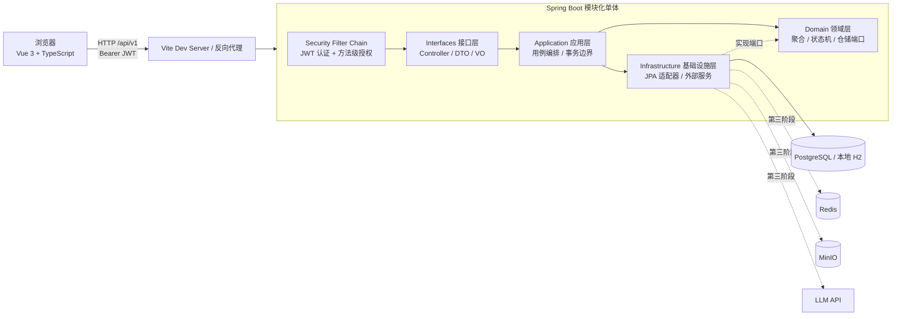
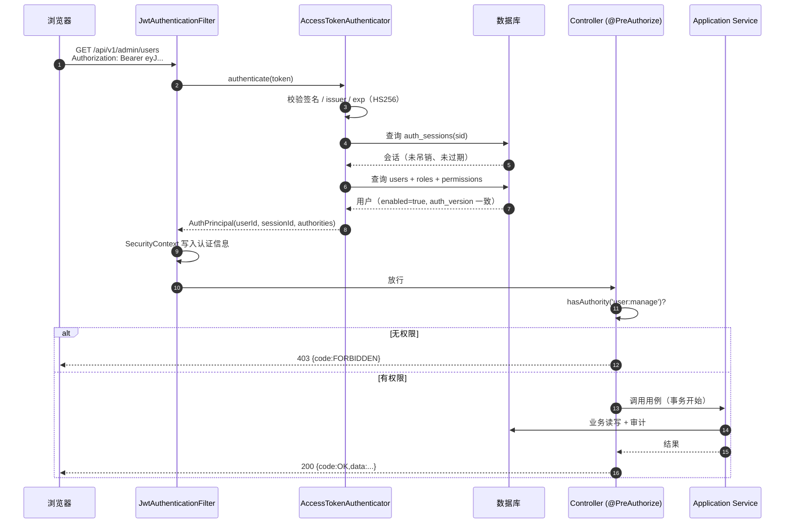

# 01 · 架构设计

## 1. 总体架构



技术栈实际版本（第一阶段）：

| 层 | 技术 | 版本 |
| --- | --- | --- |
| 前端 | Vue 3 / TypeScript / Vite / Vue Router / Axios | 3.5 / 5.7 / 6.4 / 4.5 / 1.7 |
| 后端 | JDK / Spring Boot / Spring Security | 17 / 3.4.13 / 6.4 |
| 持久化 | Spring Data JPA (Hibernate 6) / Flyway | 3.4 / 10.x |
| 数据库 | PostgreSQL 14+（生产）/ H2 2.x PostgreSQL 兼容模式（本地） | — |
| 接口文档 | springdoc-openapi (Swagger UI) | 2.8.13 |
| 测试 | JUnit 5 / Mockito / MockMvc / JaCoCo | 0.8.12 |
| 认证 | JJWT (HS256) | 0.12.6 |

> 说明：本机开发环境没有 Docker 与 PostgreSQL 服务，因此默认 profile 使用 **H2 文件库**（`./data/labflow.mv.db`，数据落盘、重启不丢），SQL 保持 PostgreSQL 兼容子集；生产 profile 直接连 PostgreSQL，同一套 Flyway 脚本。该取舍在 README「本地运行」中写明，教师无需安装数据库即可 15 分钟内跑起来。

## 2. 后端分层与包结构

```text
backend/src/main/java/com/labflow/
├── LabFlowApplication.java
├── shared/                       共享内核
│   ├── api/                      ApiResponse、PageResult、FieldErrorItem
│   ├── error/                    ErrorCode、BusinessException
│   ├── web/                      全局异常处理、traceId 过滤器、统一错误输出
│   ├── security/                 JWT、认证过滤器、安全配置、Cookie、当前用户
│   ├── audit/                    审计实体与记录器
│   └── config/                   Clock、密码策略 Bean、OpenAPI
└── identity/                     身份与授权限界上下文
    ├── domain/                   User、Role、Permission、AuthSession、RefreshToken、
    │                             PasswordPolicy、Usernames、仓储端口
    ├── application/              AuthService、UserAdminService、RoleAdminService、
    │                             AccessTokenAuthenticator、command、AuthResult
    ├── infrastructure/persistence/  JPA 实体、Spring Data 仓储、端口适配器、映射器
    └── interfaces/rest/          AuthController、MeController、AdminUserController、
                                  AdminRoleController、DTO、VO、Web 映射器
```

依赖方向：`interfaces → application → domain`，`infrastructure → domain`（实现端口）。领域层不依赖 Spring MVC、JPA 或任何具体数据库；Controller 只做参数接收、DTO 校验与 VO 映射，业务规则位于应用服务与聚合。

第二、三阶段新增 `research`（项目/任务/周报）、`organization`（实验室）、`resource`、`knowledge`、`collaboration`（通知/审计/AI），沿用同一分层。

## 3. 一次请求的认证与授权链路



关键点：

1. **JWT 不携带权限**，只带 `sub`（用户）、`sid`（会话）、`av`（授权版本）。权限每次请求从数据库重读，因此管理员改权限后无需重启、无需等令牌过期。
2. **退出登录是服务端行为**：`auth_sessions.revoked_at` 置位后，同一 `sid` 的旧令牌立即 401（`SESSION_REVOKED`），满足任务书「仅前端删 Token 不算完成」的要求。
3. **账号禁用 / 改密**会递增 `users.auth_version` 并吊销全部会话，已签发令牌下一次请求即失效。
4. 过滤器层认证失败直接写统一 JSON（401），Controller 层方法级鉴权失败抛 `AccessDeniedException`，由全局异常处理器转 403。

## 4. 统一返回与可观测性

```json
{ "code": "OK", "message": "success", "data": { }, "traceId": "9538467fee56472e" }
```

- `traceId` 由 `TraceIdFilter` 生成（或复用请求头 `X-Trace-Id`），写入 MDC 与响应头，异常时同步出现在响应体中，便于按日志定位。
- 全局异常处理覆盖：业务异常、参数校验（字段级）、消息不可读、方法参数类型不匹配、缺失参数、访问拒绝、认证失败、数据约束冲突、404、兜底 500。**任何分支都不返回堆栈。**

## 5. 配置与密钥

| 配置 | 说明 |
| --- | --- |
| `SPRING_PROFILES_ACTIVE` | 默认 `dev`（H2 文件库）；生产用 `prod`（PostgreSQL） |
| `JWT_SIGNING_KEY` | 未配置时启动生成随机密钥（重启后旧令牌失效）并打印警告；生产必须注入 ≥ 32 字节固定密钥 |
| `COOKIE_SECURE` | 本地 HTTP 为 `false`，HTTPS 部署必须 `true` |
| `DB_URL / DB_USER / DB_PASSWORD` | 仅 prod profile 使用 |

仓库中不存放任何真实密钥、口令或连接串；`.env.example` 只提供字段模板，`.env` / `application-local.yml` 已被 `.gitignore` 忽略。

## 6. 前端定位

前端只承担交互与展示，不做安全决策：

- access token 保存在内存 + `sessionStorage`，refresh token 由后端写入 HttpOnly Cookie（前端脚本不可读）；
- Axios 拦截器在 401 时做**单飞刷新**（并发请求共享同一次刷新），失败则跳转登录；
- 菜单按 `/me` 返回的权限渲染，但即使手工构造请求，后端仍会拒绝。
