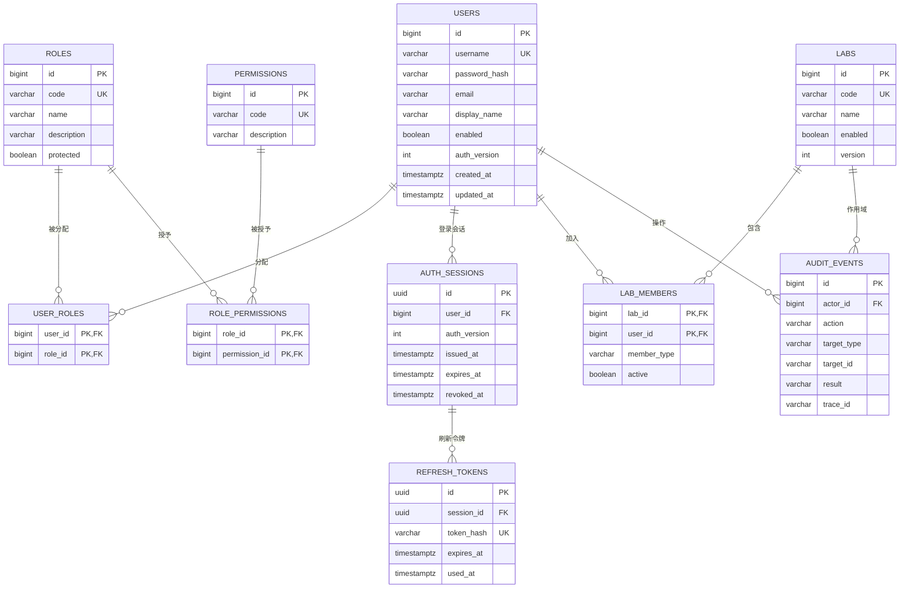

# 02 · 数据库设计

## 1. 设计原则

- 一套 DDL 同时兼容 PostgreSQL 14+ 与 H2 2.x（PostgreSQL 兼容模式），保证「本地零安装可跑 / 生产可上 PostgreSQL」。
- 主键 `BIGINT GENERATED BY DEFAULT AS IDENTITY`；会话与刷新令牌使用 `UUID`（不可猜测、可分布式生成）。
- 所有业务表含 `created_at` / `updated_at`（`TIMESTAMP WITH TIME ZONE`），时间统一按 UTC 存储。
- 外键默认 `RESTRICT`，用户与会话之间用 `CASCADE`（账号删除即回收凭证）；已验收的科研记录禁止级联删除。
- 状态字段使用 `VARCHAR + CHECK`（或应用枚举 + DB 约束双重校验）。
- 迁移由 Flyway 管理：`V1__schema.sql` 建表、`V2__seed_data.sql` 种子数据，**一次执行、可重复启动**，不需要手工 `DROP`。

> 课程要求「schema.sql + data.sql 一键建库」：本项目以等价的 Flyway 版本化迁移实现，脚本路径为
> `backend/src/main/resources/db/migration/V1__schema.sql` 与 `V2__seed_data.sql`，启动即自动执行，也可用 `psql -f` 手工执行（PostgreSQL）。

## 2. ER 关系（第一阶段）

第二、三阶段将补充：`projects`、`project_members`、`project_reviews`、`tasks`、`task_submissions`、`reports`、`report_tasks`、`resources`、`bookings`、`artifacts`、`knowledge_entries`、`attachments`、`notifications`、`ai_jobs` 等（详见项目书第 15–18 节，按同一次迁移策略分批落地）。

## 3. 表字典

### 3.1 users 用户

| 字段 | 类型 | 约束 | 说明 |
| --- | --- | --- | --- |
| id | BIGINT identity | PK | 主键 |
| username | VARCHAR(64) | NN, UQ | 规范化（去空白、转小写）后唯一 |
| password_hash | VARCHAR(100) | NN | BCrypt 加盐哈希，**任何接口不返回** |
| email | VARCHAR(254) | — | 可空 |
| display_name | VARCHAR(80) | — | 昵称 |
| enabled | BOOLEAN | NN, 默认 TRUE | 禁用后所有会话立即失效 |
| auth_version | INT | NN, 默认 0 | 改密/禁用时递增，用于批量吊销令牌 |
| created_at / updated_at | TIMESTAMPTZ | NN | 审计时间 |

索引/约束：`uq_users_username`。

### 3.2 roles 角色

| 字段 | 类型 | 约束 | 说明 |
| --- | --- | --- | --- |
| id | BIGINT identity | PK | |
| code | VARCHAR(64) | NN, UQ | `SYS_ADMIN` / `PI` / `PROJECT_LEADER` / `RESEARCHER` |
| name | VARCHAR(80) | NN | 中文名 |
| description | VARCHAR(255) | — | |
| protected | BOOLEAN | NN | 内置角色不可删除/改名，防止把系统锁死 |

### 3.3 permissions 权限

| 字段 | 类型 | 约束 | 说明 |
| --- | --- | --- | --- |
| id | BIGINT identity | PK | |
| code | VARCHAR(100) | NN, UQ | 形如 `project:approve` 的接口操作码 |
| description | VARCHAR(200) | — | 中文释义 |

权限码目录共 **49 条**，覆盖身份、组织、项目、任务、周报、资源、成果知识、通知与 AI（第一阶段实现身份/组织相关接口，其余权限码随第二、三阶段接口启用）。

### 3.4 user_roles 用户-角色

联合主键 `(user_id, role_id)`；`user_id` 级联删除，`role_id` 受限删除；`idx_user_roles_role` 支持反向查询。
支持一个用户多角色，权限集合取并集。

### 3.5 role_permissions 角色-权限

联合主键 `(role_id, permission_id)`；`idx_role_permissions_permission` 反向索引。
**权限不写死在代码里**：所有授权判断都从这两张映射表读取。

### 3.6 auth_sessions 服务端会话

| 字段 | 类型 | 约束 | 说明 |
| --- | --- | --- | --- |
| id | UUID | PK | JWT 的 `sid` 指向此列 |
| user_id | BIGINT | FK, NN | |
| auth_version | INT | NN | 签发时的授权版本快照 |
| issued_at / expires_at | TIMESTAMPTZ | NN, CHECK `expires_at > issued_at` | 与会话有效期（刷新令牌 TTL 一致） |
| revoked_at | TIMESTAMPTZ | — | 退出/禁用/改密时置位 |
| last_used_at | TIMESTAMPTZ | — | 刷新时更新 |
| client_ip / user_agent | VARCHAR | — | 审计与排障 |

### 3.7 refresh_tokens 刷新令牌

| 字段 | 类型 | 约束 | 说明 |
| --- | --- | --- | --- |
| id | UUID | PK | |
| session_id | UUID | FK, NN | 归属会话 |
| token_hash | VARCHAR(64) | NN, UQ | **只存 SHA-256 哈希**，不存明文 |
| expires_at | TIMESTAMPTZ | NN | 与会话同时到期 |
| used_at | TIMESTAMPTZ | — | 一次性使用标记，非空即视为重放 |
| revoked_at | TIMESTAMPTZ | — | 退出/禁用/复用检测时吊销 |
| created_at | TIMESTAMPTZ | NN | |

### 3.8 labs 实验室

`code`（UQ）、`name`、`description`、`enabled`、`version`（乐观并发）。停用后拒绝新业务。

### 3.9 lab_members 实验室成员

联合主键 `(lab_id, user_id)`；`member_type IN ('PI','MEMBER')`；`active` 支持退出后保留历史。作用域的来源：角色给能力，成员关系给范围。

### 3.10 audit_events 审计事件

`actor_id`、`lab_id`、`project_id`、`action`、`target_type`、`target_id`、`result`、`trace_id`、`metadata`（脱敏摘要）。
按 `(actor_id, created_at)` 与 `(action, created_at)` 建索引。**不存正文、令牌、密码**。

## 4. 一致性要点

| 场景 | 保障 |
| --- | --- |
| 用户名并发唯一 | 应用层预检查 + `uq_users_username` 唯一约束兜底（冲突转 409） |
| 退出后旧令牌不可用 | `auth_sessions.revoked_at` 在服务端校验，不依赖前端 |
| 改密/禁用立即失效 | `users.auth_version` 递增，请求校验 `av` 声明 |
| 刷新令牌重放 | `used_at` 标记 + 整个会话族吊销，见 `AuthService.refresh` |
| 最后一个管理员 | 服务查询「除本人外仍启用的管理员数量」，为 0 时拒绝禁用/降级 |
| 权限变更生效 | 每次请求从 `role_permissions` 重新加载，无缓存权限集 |

## 5. 与项目书 26 张计划表的差异

第一阶段落地 10 张表，覆盖课程「≥ 8 张」要求；剩余业务表随第二、三阶段按同一 Flyway 流程增量迁移，不修改已发布迁移脚本（保证可重复执行与历史可追溯）。
