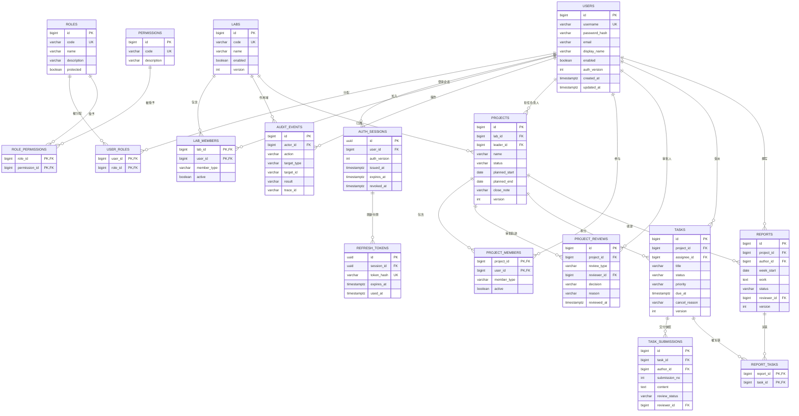

# 02 · 数据库设计

## 1. 设计原则

- 一套 DDL 同时兼容 PostgreSQL 14+ 与 H2 2.x（PostgreSQL 兼容模式），保证「本地零安装可跑 / 生产可上 PostgreSQL」。
- 主键 `BIGINT GENERATED BY DEFAULT AS IDENTITY`；会话与刷新令牌使用 `UUID`（不可猜测、可分布式生成）。
- 所有业务表含 `created_at` / `updated_at`（`TIMESTAMP WITH TIME ZONE`），时间统一按 UTC 存储。
- 外键默认 `RESTRICT`，用户与会话之间用 `CASCADE`（账号删除即回收凭证）；已验收的科研记录禁止级联删除。
- 状态字段使用 `VARCHAR + CHECK`（或应用枚举 + DB 约束双重校验）。
- 迁移由 Flyway 管理：`V1__schema.sql`（身份与授权）、`V2__seed_data.sql`（种子数据）、`V3__research_core.sql`（科研业务），**一次执行、可重复启动**，不需要手工 `DROP`。

> 课程要求「schema.sql + data.sql 一键建库」：本项目以等价的 Flyway 版本化迁移实现，脚本路径为
> `backend/src/main/resources/db/migration/`，启动即自动执行，也可用 `psql -f` 手工按 V1→V2→V3 顺序执行（PostgreSQL）。

## 2. ER 关系（17 张表全量）

**三条关系链的语义**

1. **作用域链**：`labs → lab_members` 决定"谁属于哪个实验室"，`projects → project_members` 决定"谁参与哪个项目"。角色只给能力，范围由这两条链给出，二者缺一不可。
2. **审批链**：`project_reviews` 只增不改，记录立项（`INIT`）与结项（`CLOSE`）两次决策。审批人身份与理由都落库，答辩时可直接查证"谁批的、什么理由"。
3. **交付链**：`tasks → task_submissions` 一对多。退回重提不更新旧行，而是插入 `submission_no + 1` 的新行，因此历史交付内容永久可追溯；`uq_task_submissions_no` 保证编号不重。

第三阶段将补充：`resources`、`bookings`、`artifacts`、`knowledge_entries`、`attachments`、`notifications`、`ai_jobs`（详见项目书第 15–18 节，按同一次迁移策略分批落地）。

## 3. 表字典

### 3.1 users 用户

| 字段 | 类型 | 约束 | 说明 |
| --- | --- | --- | --- |
| id | BIGINT identity | PK | 主键 |
| username | VARCHAR(64) | NN, UQ | 规范化（去空白、转小写）后唯一 |
| password_hash | VARCHAR(100) | NN | BCrypt 加盐哈希，**任何接口不返回** |
| email | VARCHAR(254) | — | 可空 |
| display_name | VARCHAR(80) | — | 昵称 |
| enabled | BOOLEAN | NN, 默认 TRUE | 禁用后所有会话立即失效 |
| auth_version | INT | NN, 默认 0 | 改密/禁用时递增，用于批量吊销令牌 |
| created_at / updated_at | TIMESTAMPTZ | NN | 审计时间 |

索引/约束：`uq_users_username`。

### 3.2 roles 角色

| 字段 | 类型 | 约束 | 说明 |
| --- | --- | --- | --- |
| id | BIGINT identity | PK | |
| code | VARCHAR(64) | NN, UQ | `SYS_ADMIN` / `PI` / `PROJECT_LEADER` / `RESEARCHER` |
| name | VARCHAR(80) | NN | 中文名 |
| description | VARCHAR(255) | — | |
| protected | BOOLEAN | NN | 内置角色不可删除/改名，防止把系统锁死 |

### 3.3 permissions 权限

| 字段 | 类型 | 约束 | 说明 |
| --- | --- | --- | --- |
| id | BIGINT identity | PK | |
| code | VARCHAR(100) | NN, UQ | 形如 `project:approve` 的接口操作码 |
| description | VARCHAR(200) | — | 中文释义 |

权限码目录共 **49 条**，覆盖身份、组织、项目、任务、周报、资源、成果知识、通知与 AI。其中 **26 条已被接口用 `@PreAuthorize` 强制校验**（身份/组织/项目/任务/周报），资源、成果知识、通知、AI 相关权限码已入库但接口属第三阶段。

### 3.4 user_roles 用户-角色

联合主键 `(user_id, role_id)`；`user_id` 级联删除，`role_id` 受限删除；`idx_user_roles_role` 支持反向查询。
支持一个用户多角色，权限集合取并集。

### 3.5 role_permissions 角色-权限

联合主键 `(role_id, permission_id)`；`idx_role_permissions_permission` 反向索引。
**权限不写死在代码里**：所有授权判断都从这两张映射表读取。

### 3.6 auth_sessions 服务端会话

| 字段 | 类型 | 约束 | 说明 |
| --- | --- | --- | --- |
| id | UUID | PK | JWT 的 `sid` 指向此列 |
| user_id | BIGINT | FK, NN | |
| auth_version | INT | NN | 签发时的授权版本快照 |
| issued_at / expires_at | TIMESTAMPTZ | NN, CHECK `expires_at > issued_at` | 与会话有效期（刷新令牌 TTL 一致） |
| revoked_at | TIMESTAMPTZ | — | 退出/禁用/改密时置位 |
| last_used_at | TIMESTAMPTZ | — | 刷新时更新 |
| client_ip / user_agent | VARCHAR | — | 审计与排障 |

### 3.7 refresh_tokens 刷新令牌

| 字段 | 类型 | 约束 | 说明 |
| --- | --- | --- | --- |
| id | UUID | PK | |
| session_id | UUID | FK, NN | 归属会话 |
| token_hash | VARCHAR(64) | NN, UQ | **只存 SHA-256 哈希**，不存明文 |
| expires_at | TIMESTAMPTZ | NN | 与会话同时到期 |
| used_at | TIMESTAMPTZ | — | 一次性使用标记，非空即视为重放 |
| revoked_at | TIMESTAMPTZ | — | 退出/禁用/复用检测时吊销 |
| created_at | TIMESTAMPTZ | NN | |

### 3.8 labs 实验室

`code`（UQ）、`name`、`description`、`enabled`、`version`（乐观并发）。停用后拒绝新业务。

### 3.9 lab_members 实验室成员

联合主键 `(lab_id, user_id)`；`member_type IN ('PI','MEMBER')`；`active` 支持退出后保留历史。作用域的来源：角色给能力，成员关系给范围。

### 3.10 audit_events 审计事件

`actor_id`、`lab_id`、`project_id`、`action`、`target_type`、`target_id`、`result`、`trace_id`、`metadata`（脱敏摘要）。
按 `(actor_id, created_at)` 与 `(action, created_at)` 建索引。**不存正文、令牌、密码**。

### 3.11 projects 科研项目

| 字段 | 类型 | 约束 | 说明 |
| --- | --- | --- | --- |
| id | BIGINT identity | PK | |
| lab_id | BIGINT | NN, FK→labs(RESTRICT) | 归属实验室，作用域根 |
| leader_id | BIGINT | NN, FK→users(RESTRICT) | 项目负责人，只有此人能维护成员与任务 |
| name | VARCHAR(150) | NN | |
| objective | VARCHAR(2000) | — | 项目目标 |
| status | VARCHAR(32) | NN, CHECK | `DRAFT`/`PENDING`/`ACTIVE`/`CLOSING`/`ARCHIVED`/`REJECTED` |
| planned_start / planned_end | DATE | `ck_projects_plan` 保证 end ≥ start | |
| close_note | VARCHAR(2000) | — | 申请结项时填写，结项被退回时保留原文便于修改 |
| version | INT | NN, 默认 0 | 乐观锁 |
| created_at / updated_at | TIMESTAMPTZ | NN | |

索引：`idx_projects_lab_status (lab_id, status)`（列表页主查询）、`idx_projects_leader`。

> `status` 只允许通过 `/submit`、`/approve`、`/reject`、`/reopen`、`/close-request`、`/close-approve`、`/close-reject` 这些命令接口迁移，通用 `PUT /projects/{id}` 不接受 `status` 字段——否则状态机形同虚设。

### 3.12 project_members 项目成员

| 字段 | 类型 | 约束 | 说明 |
| --- | --- | --- | --- |
| project_id | BIGINT | PK, FK→projects(CASCADE) | |
| user_id | BIGINT | PK, FK→users(RESTRICT) | |
| member_type | VARCHAR(16) | NN, CHECK | `LEADER` / `MEMBER` |
| active | BOOLEAN | NN, 默认 TRUE | 移除成员置 false，保留历史 |
| joined_at | TIMESTAMPTZ | NN | |

索引：`idx_project_members_user`（"我参与的项目"反向查询）。创建项目时同步写入一条 `LEADER` 记录，服务层保证每个项目只有一个有效负责人。

### 3.13 project_reviews 立项/结项审批轨迹

| 字段 | 类型 | 约束 | 说明 |
| --- | --- | --- | --- |
| id | BIGINT identity | PK | |
| project_id | BIGINT | NN, FK→projects(CASCADE) | |
| review_type | VARCHAR(16) | NN, CHECK | `INIT`（立项）/ `CLOSE`（结项） |
| reviewer_id | BIGINT | NN, FK→users(RESTRICT) | 审批人 |
| decision | VARCHAR(16) | NN, CHECK | `APPROVE` / `REJECT` |
| reason | VARCHAR(1000) | — | 驳回时服务层强制非空 |
| reviewed_at | TIMESTAMPTZ | NN | 决策时间 |
| created_at | TIMESTAMPTZ | NN | |

索引：`idx_project_reviews_project (project_id, created_at)`。**只增不改**，没有任何 UPDATE/DELETE 路径。

### 3.14 tasks 科研任务

| 字段 | 类型 | 约束 | 说明 |
| --- | --- | --- | --- |
| id | BIGINT identity | PK | |
| project_id | BIGINT | NN, FK→projects(CASCADE) | 归属项目，所有按 taskId 的访问都先反查它再校验成员关系 |
| assignee_id | BIGINT | NN, FK→users(RESTRICT) | 受派人，只有此人能 `start` / `submit` |
| title | VARCHAR(150) | NN | |
| description | VARCHAR(4000) | — | |
| status | VARCHAR(32) | NN, CHECK | `TODO`/`IN_PROGRESS`/`SUBMITTED`/`DONE`/`RETURNED`/`CANCELED` |
| priority | VARCHAR(16) | NN, 默认 `NORMAL`, CHECK | `LOW`/`NORMAL`/`HIGH` |
| due_at | TIMESTAMPTZ | — | |
| cancel_reason | VARCHAR(500) | — | 取消必填 |
| version | INT | NN, 默认 0 | 乐观锁 |

索引：`idx_tasks_project_status`（项目任务列表）、`idx_tasks_assignee_status`（我的任务）。进度 = `DONE` 数 ÷ 非 `CANCELED` 任务数，取消的任务不拉低进度。

### 3.15 task_submissions 任务交付快照

| 字段 | 类型 | 约束 | 说明 |
| --- | --- | --- | --- |
| id | BIGINT identity | PK | |
| task_id | BIGINT | NN, FK→tasks(CASCADE) | |
| author_id | BIGINT | NN, FK→users(RESTRICT) | 提交人（= 受派人） |
| submission_no | INT | NN, `uq_task_submissions_no` | 同任务内递增，1 起 |
| content | VARCHAR(4000) | NN | 交付正文，**永不被后续提交覆盖** |
| review_status | VARCHAR(16) | NN, CHECK | `SUBMITTED`/`APPROVED`/`RETURNED` |
| reviewer_id | BIGINT | FK→users(SET NULL) | 审核人被删除时置空，不删快照 |
| review_note | VARCHAR(1000) | — | 退回理由/验收意见 |
| reviewed_at | TIMESTAMPTZ | — | |
| created_at | TIMESTAMPTZ | NN | |

索引：`idx_task_submissions_task (task_id, created_at)`。

> 为什么单独建表而不是在 `tasks` 上加一列 `last_submission`：退回重提是常态，一列只能存最后一次，历史被覆盖就无法回答"第一次交了什么、为什么被退回"。快照表让每一次交付都可追溯，代价只是多一张表。

### 3.16 reports 进度周报

| 字段 | 类型 | 约束 | 说明 |
| --- | --- | --- | --- |
| id | BIGINT identity | PK | |
| project_id | BIGINT | NN, FK→projects(CASCADE) | |
| author_id | BIGINT | NN, FK→users(RESTRICT) | 作者，不能审核自己的周报 |
| week_start | DATE | NN, `uq_reports_week` | **已归一到周一** |
| work / blockers / next_plan | VARCHAR(4000/2000/2000) | — | 本周工作 / 阻塞项 / 下周计划 |
| status | VARCHAR(16) | NN, CHECK | `DRAFT`/`SUBMITTED`/`APPROVED`/`RETURNED` |
| reviewer_id | BIGINT | FK→users(SET NULL) | |
| review_note | VARCHAR(1000) | — | |
| version | INT | NN, 默认 0 | 乐观锁 |
| created_at / updated_at | TIMESTAMPTZ | NN | |

唯一约束：`uq_reports_week (project_id, author_id, week_start)`。索引：`idx_reports_project_status`。

> 周起始归一发生在服务层（`weekStart.with(DayOfWeek.MONDAY)`），**必须在写库前完成**：否则 `2026-11-25`（周三）与 `2026-11-23`（周一）会被唯一约束当成两周，同一周能提交两份周报。唯一约束是兜底，不是唯一防线。

### 3.17 report_tasks 周报关联任务

| 字段 | 类型 | 约束 | 说明 |
| --- | --- | --- | --- |
| report_id | BIGINT | PK, FK→reports(CASCADE) | |
| task_id | BIGINT | PK, FK→tasks(CASCADE) | |

索引：`idx_report_tasks_task`。服务层校验"任务必须与周报同项目"——数据库层面无法用外键表达这个约束（`task_id` 与 `report_id` 各自有效即可满足外键），所以这条规则只能由应用保证，并在 `ReportApiTest` 里有对应负例。

## 4. 一致性要点

| 场景 | 保障 |
| --- | --- |
| 用户名并发唯一 | 应用层预检查 + `uq_users_username` 唯一约束兜底（冲突转 409） |
| 退出后旧令牌不可用 | `auth_sessions.revoked_at` 在服务端校验，不依赖前端 |
| 改密/禁用立即失效 | `users.auth_version` 递增，请求校验 `av` 声明 |
| 刷新令牌重放 | `used_at` 标记 + 整个会话族吊销，见 `AuthService.refresh` |
| 最后一个管理员 | 服务查询「除本人外仍启用的管理员数量」，为 0 时拒绝禁用/降级 |
| 权限变更生效 | 每次请求从 `role_permissions` 重新加载，无缓存权限集 |
| 项目状态并发迁移 | `projects.version` 乐观锁，过期版本 409 `VERSION_CONFLICT`；状态迁移只在聚合方法内 |
| 同一周重复周报 | 服务层先把 `week_start` 归一到周一，再预检 + `uq_reports_week` 兜底 |
| 交付快照不丢历史 | 退回重提插入新行（`submission_no + 1`），`uq_task_submissions_no` 防重 |
| 审批轨迹不可篡改 | `project_reviews` 只增不改，无 UPDATE/DELETE 代码路径 |
| 结项时仍有未完成任务 | 应用服务在 `requestClose` 前统计非取消任务，存在未完成即 409 `OPEN_TASKS_EXIST` |
| 任务被跨项目周报引用 | 应用服务校验 `task.projectId == report.projectId`，外键无法表达，故必须有负例测试 |

## 5. PostgreSQL 兼容性验证

`PostgresApiTest` 在测试启动时拉起一个临时 PostgreSQL 16 实例（嵌入式，无需 Docker），由 Flyway 执行与生产完全相同的
`V1__schema.sql` / `V2__seed_data.sql` / `V3__research_core.sql`，并验证：**17 张表**创建成功（含 7 张业务表且初始为空）、
4 角色/49 权限/5 账号/2 实验室种子一致、用户名唯一约束生效、退出后会话 `revoked_at` 落库、禁用账号后 `auth_version` 递增、
动态权限与审计在多表事务中生效。
因此「本地 H2、生产 PostgreSQL」不再是文档假设，而是有测试证据的兼容性结论。

> 早期断言写的是"恰好 10 张表"，加 V3 后必然失败。改为 17 张并额外断言"7 张新表存在且为空"，把"迁移执行过"和"表真的建出来了"两件事分开验证。

## 6. 与项目书 26 张计划表的差异

已落地 **17 张**（身份与授权 10 张 + 科研业务 7 张），覆盖课程「≥ 8 张」要求；剩余 `resources`、`bookings`、`artifacts`、`knowledge_entries`、`attachments`、`notifications`、`ai_jobs` 等随第三阶段按同一 Flyway 流程增量迁移，**不修改已发布的迁移脚本**（保证可重复执行与历史可追溯）。

> 为什么拆成 V1/V2/V3 而不是一个大脚本：迁移一旦在别人机器上执行过，修改它就会导致 `flyway_schema_history` 校验和不一致而启动失败。增量迁移是唯一安全的演进方式。
