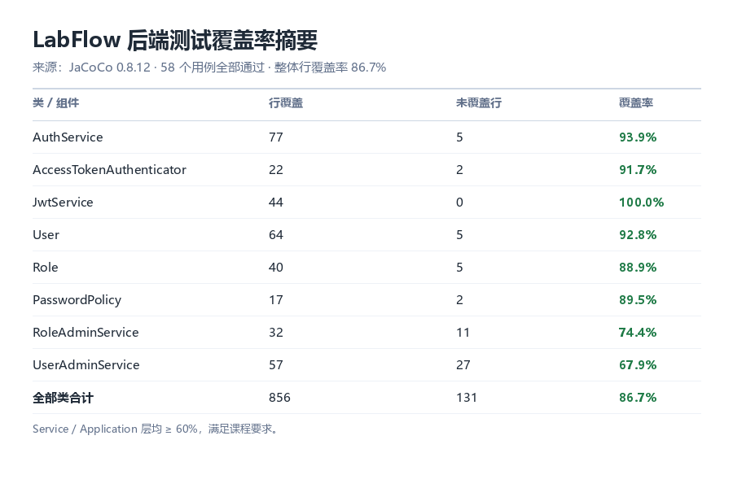

# 测试说明

## 1. 一键运行

```bash
cd backend
# Windows
mvnw.cmd test
# macOS / Linux
./mvnw test
```

生成覆盖率报告（Surefire + JaCoCo）：

```bash
cd backend
mvnw.cmd verify
# 报告位置：target/site/jacoco/index.html
```

> 本机验证使用 JDK 17 + Maven 3.9.11；依赖从 Maven Central / 阿里云镜像下载。
> 测试使用 H2 内存库并执行**真实 Flyway 迁移脚本**，因此同时验证了 DDL 与种子数据的可用性。

## 2. 测试结果（实测）

| 指标 | 数值 |
| --- | --- |
| 有效用例数 | **58** |
| 失败 / 错误 | 0 |
| 接口级（Controller / MockMvc）用例 | 28（认证 14 + RBAC 14） |
| 领域 / 服务单元用例 | 30 |
| 整体行覆盖率 | **86.7%** |
| Service / Application 层行覆盖率 | AuthService 93.9%、AccessTokenAuthenticator 91.7%、RoleAdminService 74.4%、UserAdminService 67.9% |



## 3. 用例清单

### 3.1 认证接口 `AuthApiTest`（14）

| # | 场景 | 关键断言 |
| --- | --- | --- |
| 1 | 注册成功 | 201；默认 `RESEARCHER`；响应无 `password`/`passwordHash`；traceId 非空 |
| 2 | 注册重名 | 409 `DUPLICATE_USERNAME` |
| 3 | 用户名大小写归一化 | 大写重名同样 409 |
| 4 | 弱密码（长度不足） | 400 `VALIDATION_FAILED` |
| 5 | 弱密码（无数字） | 400，提示「密码必须同时包含字母和数字」 |
| 6 | 非法用户名 | 400 且返回字段级错误 |
| 7 | 登录成功 | 200；返回 access token；下发 HttpOnly `labflow_refresh`；权限含 `report:create` |
| 8 | 密码错误 | 401 `INVALID_CREDENTIALS`，提示统一 |
| 9 | 用户不存在 | 与密码错误完全一致的 401 与提示 |
| 10 | 未携带令牌 | 401 `UNAUTHENTICATED` |
| 11 | 伪造令牌 | 401 `TOKEN_INVALID` |
| 12 | 当前用户 | 200，返回角色、权限、授权版本 |
| 13 | **退出后旧令牌** | 退出 204；同一令牌再访问 `/me` → 401 `SESSION_REVOKED` |
| 14 | **刷新轮换与重放** | 刷新成功；旧刷新令牌重放 → 401；新 access token 随会话吊销失效 |

### 3.2 RBAC 接口 `RbacApiTest`（14）

| # | 场景 | 关键断言 |
| --- | --- | --- |
| 1 | 普通用户调用 `/admin/**` | 403 `FORBIDDEN`（users / roles / permissions 三处） |
| 2 | 管理员分页 + 关键字筛选 | total 正确、page/size 回显、每页条数受限 |
| 3 | 管理员创建用户并分配角色 | 201；新用户可登录且角色为 `PI` |
| 4 | 替换用户角色集合 | 200，角色数为 2 |
| 5 | 分配未知角色 | 400 `VALIDATION_FAILED` |
| 6 | **禁用账号** | 200；该用户已有令牌立即 401；再登录返回统一失败提示 |
| 7 | **最后一个管理员** | 禁用自己 → 409 `LAST_ADMIN_PROTECTED` |
| 8 | **动态权限生效** | 新角色权限 0 → 管理员授予 → 同一令牌下一次请求可见新权限 |
| 9 | 内置角色删除 | 409 `PROTECTED_ROLE` |
| 10 | 被引用角色删除 | 409 `ROLE_IN_USE` |
| 11 | 角色编码重复 | 409 `DUPLICATE_ROLE_CODE` |
| 12 | 权限目录 | ≥ 40 条，包含 `project:approve`、`task:review` |
| 13 | 参数校验 | 400 且返回字段级错误 |
| 14 | 未知路径 | 404 `NOT_FOUND`（不是 500） |

### 3.3 领域与服务单元测试（30）

| 测试类 | 数量 | 覆盖点 |
| --- | --- | --- |
| `AuthServiceTest` | 6 | 注册哈希与默认角色、重名不落库、登录建会话与双令牌、三类失败统一、退出吊销、刷新重放吊销会话族 |
| `AccessTokenAuthenticatorTest` | 5 | 有效令牌、会话吊销、未知会话、授权版本不一致、账号禁用 |
| `JwtServiceTest` | 6 | 签发/解析、过期、篡改、异源签名、短密钥拒绝、随机密钥生成 |
| `PasswordPolicyTest` | 6 | 合法、过短、纯字母/纯数字、空白、下限、超长 |
| `UserDomainTest` | 7 | 注册初始状态、禁用递增版本、改密递增版本、多角色并集、只读集合、受保护角色、权限替换 |

## 4. 手工冒烟记录（真实 HTTP）

```text
GET  /actuator/health                        -> 200 {"status":"UP"}
POST /api/v1/auth/login (admin_demo)         -> 200, code=OK, 权限 7 项
GET  /api/v1/me (admin)                      -> 200, roles=[SYS_ADMIN]
GET  /api/v1/admin/users?page=1&size=3       -> 200, total=5, items=3
GET  /api/v1/admin/roles?size=10             -> 200, total=4
GET  /api/v1/admin/users (无令牌)             -> 401
POST /api/v1/auth/login (researcher_a)       -> 200, 权限 26 项
POST /api/v1/auth/logout                     -> 204
GET  /api/v1/me (退出后旧令牌)                -> 401 {"code":"SESSION_REVOKED"}
POST /api/v1/auth/login (错误口令)            -> 401 {"code":"INVALID_CREDENTIALS","message":"用户名或密码错误"}
GET  /v3/api-docs                            -> 200, 12195 bytes
```

## 5. 尚未覆盖（如实说明）

- 未做 PostgreSQL + Testcontainers 集成测试（本机无 Docker），第二阶段补真实数据库并发用例；
- 未做浏览器 E2E（第一阶段的接口契约已由 MockMvc 覆盖，E2E 列为第三阶段附加项）；
- 未做压力测试、Redis 失效回退、WebSocket 认证等第三阶段内容。

## 6. 覆盖率口径

JaCoCo 统计 `LINE_COVERED / (LINE_COVERED + LINE_MISSED)`，排除启动类、DTO/VO 与 JPA 实体，配置见 `backend/pom.xml` 的 `jacoco-maven-plugin`。
要求「Service 层 ≥ 60%」按类逐项核对：最低为 `UserAdminService` 67.9%，全部达标。
